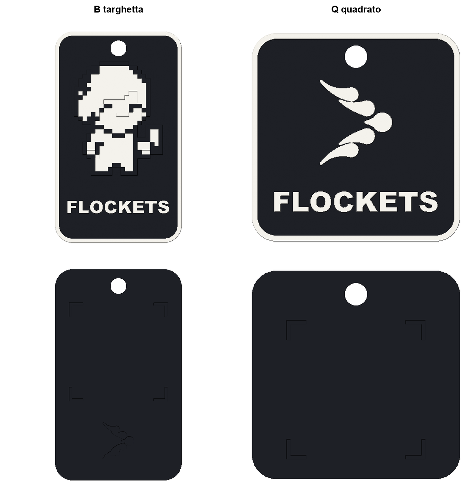

# Portachiavi Flockets in 3D

Portachiavi e ciondoli da stampare in 3D, con gli omini del sito, il nome e il logo. Due modelli, entrambi col foro
(Ø 4.5 mm) in cima al centro e il retro piatto per il QR.



| Modello | Misure (mm) | Fronte | Retro |
|---|---|---|---|
| **B targhetta** | 36 × 60 × 4.4 | omino in rilievo, nome dritto | QR 28 mm, logo inciso |
| **Q quadrato** | 42 × 42 × 4.0 | logo e nome | QR 28 mm |

## Cartelle

- `modelli/` STL senza QR: sul retro ci sono quattro angoli incisi che segnano dove attaccare l'adesivo.
- Con `--qr` (vedi sotto) il QR viene intarsiato nel retro: un `.3mf` con due parti (`corpo` e `qr`),
  più i due STL separati. Ogni modello può avere il suo QR: lancia il comando una volta per modello con `--solo`.

## Stampare

- Il retro va sul piatto, il rilievo guarda in alto: niente supporti. Layer 0.2 mm, ugello 0.4,
  3-4 perimetri, riempimento 20-30%. PLA o PETG.
- **Un colore**: stampa l'STL così com'è. L'omino ha tre altezze (contorni più alti), che si leggono anche in
  un solo colore.
- **Due colori senza AMS** (come le anteprime): cambio filamento a **3.0 mm** (dallo scuro al chiaro) e di
  nuovo a **4.0 mm** (dal chiaro allo scuro). Viene la piastra scura, l'omino chiaro col contorno scuro,
  scritte e logo chiari.
- **QR intarsiato (serve AMS o multi-materiale)**: apri il `.3mf`, carica come un oggetto con più parti,
  `corpo` chiaro e `qr` scuro. Il QR sta nei primi 0.6 mm sul piatto, quindi viene netto. Su piatto liscio
  è ancora meglio.
- **QR senza AMS**: stampa il modello di `modelli/` e attacca un adesivo con il QR tra i quattro angoli.

## Rigenerare (altro omino, altro nome, altro QR)

```bash
python3 -m venv stampa3d/.venv
stampa3d/.venv/bin/pip install manifold3d trimesh shapely matplotlib pillow numpy qrcode lxml networkx
stampa3d/.venv/bin/python stampa3d/genera.py --solo B_targhetta --omino 5 --qr "https://link-della-targhetta"
stampa3d/.venv/bin/python stampa3d/genera.py --solo Q_quadrato --qr "https://link-del-quadrato"
stampa3d/.venv/bin/python stampa3d/anteprima.py
```

- `--omino N` sceglie il personaggio (0-99, nell'ordine di `web/assets/personaggi.json`: 0 Studentessa,
  1 Impiegato, 2 Muratore, 3 Giardiniere, 4 Idraulico, 5 Maestra, 6 Nonno, 7 Nonna, 8 Podista, 9 Gamer,
  10 Punk, 11 Skater, …).
- `--qr` è facoltativo; senza, il retro ha i segni per l'adesivo. Il programma avvisa se i quadratini del QR
  vengono sotto 0.8 mm: in quel caso conviene un link più corto.
- `--solo B_targhetta` o `--solo Q_quadrato` genera un modello solo (serve per dare a ognuno il suo QR).
- Le misure (spessore, rilievi, foro) stanno in cima a `genera.py`. Il font è Arial Black di macOS.
